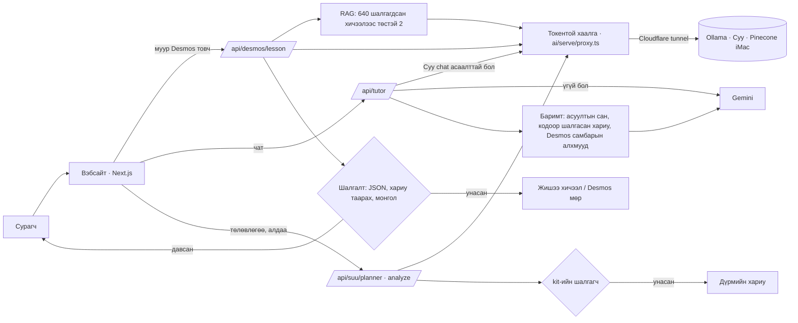

# AI хэсгүүд хэрхэн холбогддог вэ

## Дүрэм

1. **Баримтыг код шийднэ.** Зөв хариу, сурагчийн хариу зөв эсэх, төлөвлөгөөний минут — бүгд кодоор. Загварууд
   (Суу, Gemini) тайлбарлана.
2. **Загварын хариуг шалгаад л харуулна.** Шалгалт унавал жишээ/дүрмийн хариу, шошготой.
3. **Хариу задрахгүй.** Сурагч хариулаагүй бол хариутай алхам түгжээтэй, чат руу ч явахгүй.
4. **Нууц сервер дээр.** `OLLAMA_TOKEN`, `GEMINI_API_KEY` хэзээ ч хөтөч, git руу явахгүй.

## Файлууд

| Юу | Хаана |
| --- | --- |
| Суу-гийн сургалт (Colab) | `ai/train/suu_v2.ipynb`, өгөгдөл `ai/v2/`, `ai/data/tuning-v2/` |
| Git дэх загвар (adapter) + угсралт | `ai/models/suu-v1/`, `ai/serve/build-model.sh` |
| iMac дээр асаах | `ai/serve/start.sh`, хаалга `ai/serve/proxy.ts` |
| Ollama клиент, чадвар асаах/унтраах | `src/server/ai/ollama-client.ts` (`OLLAMA_SKILLS`) |
| Desmos хичээл | `src/server/ai/desmos-lesson.ts`, шалгалт `src/features/tutor/lib/desmos-lesson-parse.ts` |
| Desmos самбар | `src/features/tutor/components/DesmosSidePanel.tsx` |
| Чат (Gemini + баримт) | `src/server/ai/gemini-chat.ts`, `src/app/api/tutor/route.ts` |
| Төлөвлөгөө, алдааны дүгнэлт | `src/server/ai/suu-skills.ts`, `src/server/ai/student-input.ts` |
| Үнэлгээ | `ai/models/EVAL.md` |
